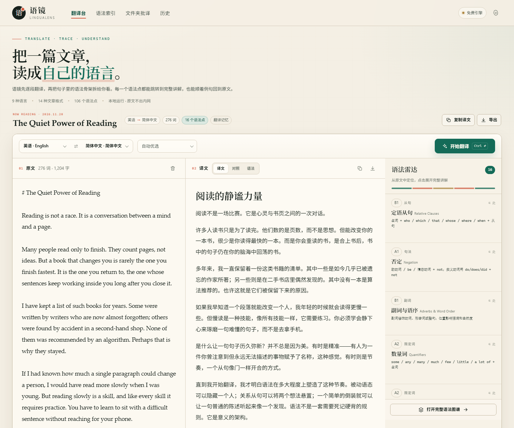
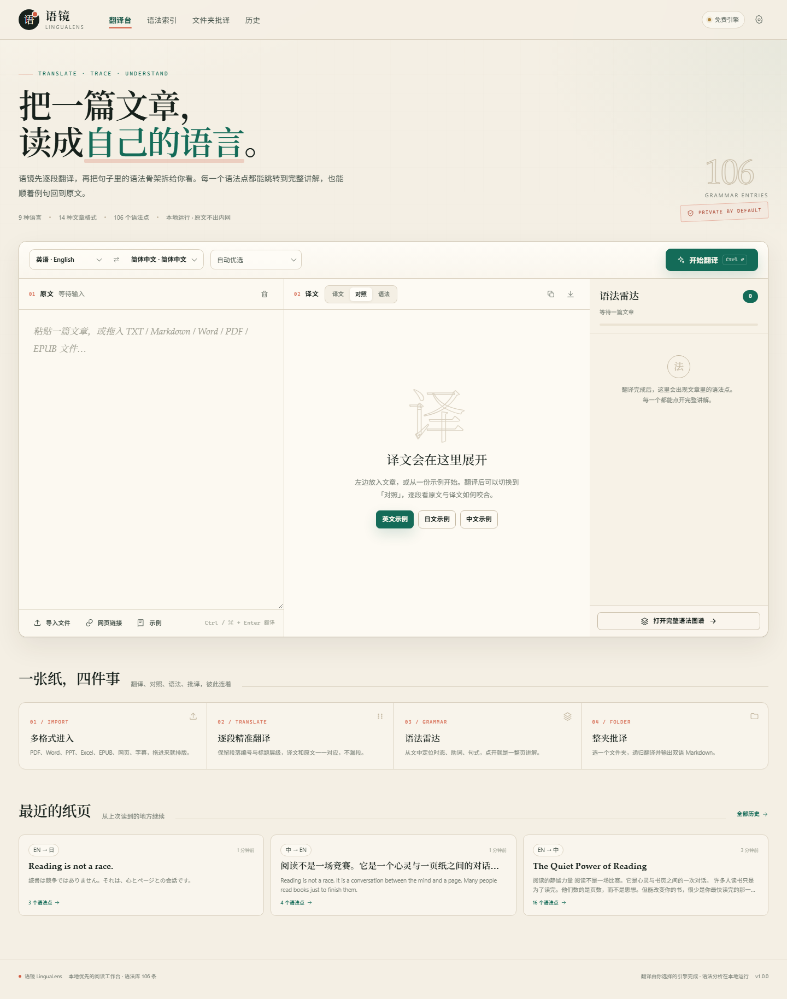
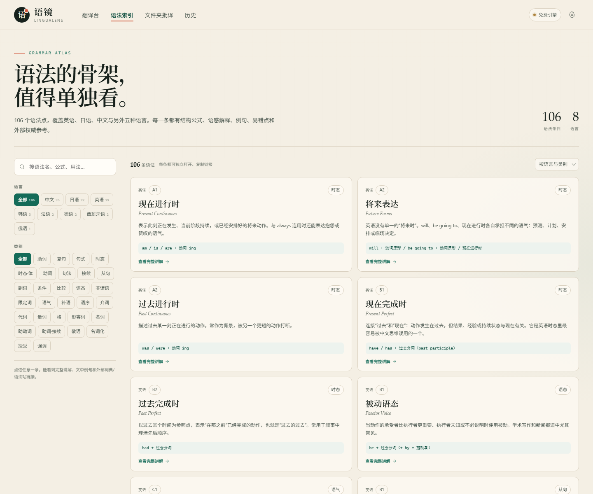
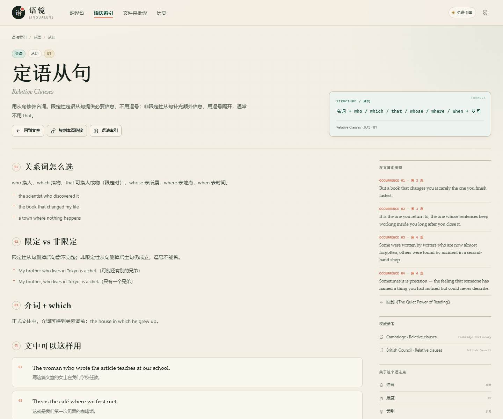
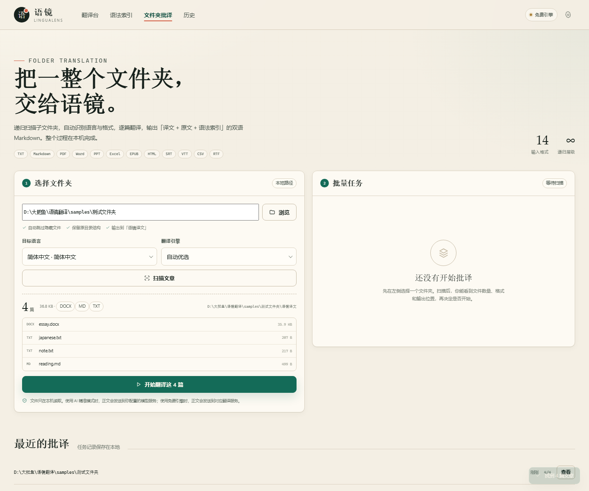

# 语镜 LinguaLens

**把一篇文章，读成自己的语言。**

语镜是一个本地运行的阅读工作台：把文章逐段翻译成中文 / 英文 / 日文等语言，同时从原文中定位语法点；每个语法点都有独立的完整讲解页，可以像翻索引一样跳转、对照、回溯原文。

它不是只会“输入一段、输出一段”的翻译框，而是一套围绕**阅读**组织的工作流：

```
文章 → 语言识别 → 逐段翻译 → 原文/译文对照 → 语法雷达 → 语法详情页 → 回到原句
```



| 首页 | 语法图谱 |
|---|---|
|  |  |
| **语法详情** | **文件夹批译** |
|  |  |

---

## 1. 快速开始

### 绿色免安装版（推荐，已打包）

解压 `语镜LinguaLens-1.0.0-Portable.zip`，然后：

1. 双击 **`启动语镜.vbs`**。
2. 浏览器会自动打开 `http://127.0.0.1:8765`，这就是完整软件界面。
3. 想退出时，双击 **`停止语镜.vbs`**；也可以在页面右上角设置里点「退出语镜（桌面版）」。
4. 需要桌面图标，双击 **`创建桌面快捷方式.vbs`**。

绿色版使用 Python 官方签名的运行时，不写注册表、不需要管理员权限；历史、设置、缓存都在解压目录的 `data` 文件夹里，整个文件夹可以移动到 U 盘或其他电脑。

> 为什么不直接给单文件 exe：这台机器的 Windows **Smart App Control** 会拦截未签名的 PyInstaller 程序。绿色版改用系统信任的签名 Python 宿主，因此不需要关闭系统安全设置。

### 手机 / 公网访问

电脑本机版只监听 `127.0.0.1`，手机不能直接打开。要让手机用，需要把服务部署到公网：

- **GitHub 是代码仓库，不是服务器**；GitHub Pages 只能放静态页，跑不了 Python 后端。
- 推荐 **GitHub + Render**：代码推到 GitHub，Render 用 Docker 运行，自动给 HTTPS 域名。
- 仓库里已经带 `Dockerfile`、`render.yaml`、`DEPLOY.md`，按 `DEPLOY.md` 操作即可。
- 公网模式必须设置 `LINGUALENS_PASSWORD`（单用户 Basic Auth）；不设置会拒绝启动，避免历史记录裸奔。
- 免费 Render 实例会休眠，SQLite 历史在重新部署后可能丢失；要长期保存就挂 1 GB Persistent Disk 到 `/data`。

---

### 源码 / 开发模式

双击 **`启动语镜.bat`**（或项目里的「语镜 LinguaLens」快捷方式）。

脚本会自动使用项目里的 `.venv`，启动本地服务并打开浏览器。窗口不要关；关掉窗口即停止服务。

首次在新电脑上运行：

```powershell
cd "D:\大肥鱼\语镜翻译"
python -m venv .venv
.venv\Scripts\python.exe -m pip install -r requirements.txt
.venv\Scripts\python.exe server.py --open
```

也可以直接：

```powershell
python server.py --open
# 或者不自动开浏览器
python server.py
```

默认地址：<http://127.0.0.1:8765>。端口被占用时会自动顺延。

> 只监听 `127.0.0.1`，不会把服务暴露到局域网。页面只能在这台电脑上打开。

### 安装成桌面应用（PWA）

使用 Chrome / Edge 打开 `http://127.0.0.1:8765`，地址栏右侧会出现“安装”图标；或打开菜单 →「安装语镜 / 创建快捷方式」。安装后可以像普通软件一样从开始菜单或桌面启动。

---

## 2. 核心能力

### 2.0 三套界面主题

- **纸墨**：温暖的纸张底色、衬线大标题，默认的阅读感。
- **暗夜**：深色底、青绿高亮，适合晚上看长文。
- **清透**：白底细线、无衬线标题，更接近现代效率工具。

右上角的主题按钮可以循环切换；也可以打开设置 →「输出与语法」→「界面主题」。选择会写入本地设置，刷新和下次启动都会保持。

### 2.0.1 阅读与导出

- **阅读字号**：译文区右上角 `A− / A+`，在 85%–130% 之间调整，自动记住。
- **历史搜索**：历史页可以按标题、原文、译文关键词筛选。
- **Word 导出**：译文右上角「Word」，导出包含译文、原文和语法索引的 `.docx`，不需要安装 Office 组件。
- **翻译风格**：设置 →「翻译引擎」→「翻译偏好」，可选自然、忠实、学术、文学。
- **术语表**：每行 `原文 = 译文`，对所有翻译引擎生效，适合人名、品牌、专业词。

### 2.0.2 独立对照页与点词卡片

- 顶部导航的 **「对照阅读」** 是独立页面：左边原文、右边译文，逐段对齐。
- 右侧可以在 **译文 / 语法 / 查词** 之间切换；语法页会列出这篇文章里的语法点。
- 在原文或译文里 **点任意单词**，会在词的上方或下方弹出单词卡片，显示音标、词性、中文释义、原句，并可以朗读、复制。
- 查词会把当前单词发给有道词典；不会上传整篇文章。断网时卡片会提示查询失败。

### 2.1 多格式文章

| 类型 | 扩展名 | 说明 |
|---|---|---|
| 纯文本 / Markdown | `.txt` `.md` `.markdown` | 保留标题、列表、引用、代码块 |
| Word | `.docx` | 读取段落、标题样式；表格按单元格顺序提取 |
| PDF | `.pdf` | 使用 `pypdf` 提取文字；扫描版需先 OCR |
| 网页 | `.html` `.htm` | 提取正文，去掉脚本、导航、页脚 |
| 电子书 | `.epub` | 按章节合并 XHTML |
| 字幕 | `.srt` `.vtt` | 去掉序号与时间轴，只保留台词 |
| 演示文稿 | `.pptx` | 按幻灯片提取标题与正文 |
| 表格 | `.xlsx` | 读取共享字符串与单元格；每行转为可翻译文本 |
| CSV / RTF | `.csv` `.rtf` | 提取为段落 |

支持：

- 直接粘贴文章
- 拖拽文件到左侧原文区
- 从公开网页链接抓取正文（会拦截内网地址）
- PDF / Word 等文件上传后自动解析，并自动开始翻译

### 2.2 逐段翻译，不漏段

文章会先切分成段落 / 标题 / 列表 / 引用 / 代码块，再交给翻译引擎。返回时按块 ID 对齐，所以：

- 标题还是标题，列表还是列表
- 译文与原文可以逐段对照
- 代码块和表格默认保留原文，避免被翻译破坏
- 相同段落会进入本地翻译记忆，节省免费额度与 AI 费用

翻译引擎：

| 引擎 | 是否需要 Key | 说明 |
|---|---|---|
| **自动优选** | 否 | 配置了 AI Key 用 AI，否则走免费引擎 |
| **AI 精准模式** | 是 | OpenAI 兼容接口，整段上下文翻译，术语和语气最稳 |
| **MyMemory** | 否 | 公共翻译记忆，免密钥，逐段请求 |
| **Google 免费引擎** | 否 | 需要网络能访问 Google |
| **离线预览** | 否 | 断网兜底，只用于演示，质量有限 |

> 翻译质量取决于引擎。免费引擎适合快速阅读；需要出版级精度时，建议配置 AI，并在工具栏选择「AI 精准模式」。

### 2.3 语法雷达

语法分析在本地规则引擎上运行，不依赖 Key。识别结果会给出：

- 语法点名称 / 英文名 / 类别 / CEFR 难度
- 结构公式
- 在文章中出现的次数
- 具体句子和段落位置

当前内置 **106 条**语法条目：

| 语言 | 条目数 | 覆盖 |
|---|---:|---|
| 英语 | 29 | 时态、语态、从句、非谓语、条件、倒装、冠词、介词、短语动词等 |
| 日语 | 32 | は/が/を/に/で/と/の、ている、ておく、てしまう、条件形、受身、使役、敬语、授受等 |
| 中文 | 35 | 把字句、被字句、了/着/过、的/地/得、是……的、比较句、复句、补语、兼语句、量词等 |
| 韩语 / 法语 / 德语 / 西班牙语 / 俄语 | 10 | 主题/宾格助词、复合过去时、四格、ser/estar、虚拟式等入门条目 |

### 2.4 可跳转的语法详情页

每个语法点都有独立 URL：

```
http://127.0.0.1:8765/grammar/en-present-perfect
```

页面里包含：

- 结构公式
- 分节讲解（什么时候用、和相近语法怎么区分、语感）
- 双语例句
- 易错点：错误写法 / 正确写法 / 为什么
- **在本文中出现的位置**（从翻译结果点进来时显示）
- 相关语法（可继续跳转）
- 外部权威参考：Cambridge、British Council、Tae Kim、日本語NET、Chinese Grammar Wiki、汉典等

从语法详情页点「回到文章」，会切回**对照视图**并滚动到对应段落。每张语法卡片都可以复制链接、单独打开，适合做笔记或发给别人。

### 2.5 文件夹批译

「文件夹批译」页面可以：

- 递归扫描子文件夹
- 自动识别每篇的语言与格式
- 一次翻译整个文件夹
- 把结果输出到原文件夹下的 `语镜译文/`，保留原目录结构
- 每篇输出双语 Markdown：译文 + 原文 + 语法索引
- 实时查看任务进度、失败原因
- 完成后一键下载 ZIP
- 任务记录保存在本地，可再次打开

输出示例：

```
你的文件夹/
├─ chapter1.docx
├─ chapter2.pdf
└─ 语镜译文/
   ├─ chapter1.zh.md
   └─ chapter2.zh.md
```

每份 Markdown 里的语法链接指向本地服务，例如：

```
- **[定语从句 · Relative Clauses](http://127.0.0.1:8765/grammar/en-relative-clause)**
```

> 批译任务在后台线程执行。关闭服务会中断正在运行的任务；已完成的输出文件会保留。

---

## 3. 配置 AI 精准模式（可选，但推荐）

打开右上角齿轮 →「翻译引擎」：

| 字段 | DeepSeek 示例 | OpenAI 示例 |
|---|---|---|
| API Base URL | `https://api.deepseek.com/v1` | `https://api.openai.com/v1` |
| 模型 | `deepseek-chat` | `gpt-4o-mini` 等 |
| API Key | `sk-...` | `sk-...` |

支持任何兼容 `POST /chat/completions` 的服务（DeepSeek、OpenAI、SiliconFlow、OneAPI、Ollama 的 OpenAI 兼容层等）。

配置后：

- 翻译会按整段上下文进行，而不是逐句孤立翻译
- 自动补充规则库没覆盖的进阶语法点，并保存为本地讲解页
- 语法补充会校验“原文句子必须真实存在”，避免编造例句

设置保存在本机 SQLite（`data/lingualens.db`）。也可以用环境变量提供 Key：

```powershell
$env:DEEPSEEK_API_KEY="sk-..."
python server.py --open
```

环境变量里的 Key 不会被写入数据库。

---

## 4. 数据与隐私

- 服务只绑定 `127.0.0.1`
- 历史记录、设置、翻译缓存、批译任务都在本机 `data/lingualens.db`
- 原文和译文不会上传到本项目的任何服务器（本来也没有云端服务器）
- 使用免费引擎时，正文会发送到对应公共服务（MyMemory / Google）
- 使用 AI 模式时，正文会发送到你配置的 API 服务
- 语法分析、文章解析、批译调度都在本机运行
- `data/chrome-profile*` 只用于开发调试，可删除

如果文章涉密，请使用本地模型（Ollama 等）或断开外网并使用离线预览；离线预览不具备真实翻译质量。

---

## 5. 目录结构

```
语镜翻译/
├─ server.py                 # 本地 HTTP 服务、API、SPA 路由
├─ core/
│  ├─ text.py                # 语言识别、段落/句子切分、HTML 提取
│  ├─ documents.py           # PDF/Word/PPT/Excel/EPUB/HTML/字幕解析
│  ├─ translate.py           # AI / MyMemory / Google / 离线 翻译编排
│  ├─ grammar.py             # 规则语法识别引擎
│  ├─ ai.py                  # AI 语法增强（可选）
│  ├─ batch.py               # 文件夹批译任务
│  ├─ store.py               # SQLite 历史、设置、缓存、任务
│  └─ net.py                 # HTTPS CA 上下文
├─ grammar_data/
│  ├─ en.py / ja.py / zh.py / other.py   # 106 条语法条目
│  └─ __init__.py
├─ web/
│  ├─ index.html
│  ├─ assets/app.css / app.js / icons
│  ├─ manifest.webmanifest
│  └─ sw.js
├─ samples/                  # 测试用文章
├─ data/                     # 运行时数据库（自动生成）
├─ screenshots/              # 界面截图
├─ requirements.txt
├─ 启动语镜.bat
└─ README.md
```

---

## 6. 常用 API

本地服务同时是一套可调用的 API，方便接入脚本：

| 方法 | 路径 | 作用 |
|---|---|---|
| GET | `/api/health` | 服务状态、语法库统计 |
| POST | `/api/detect` | 语言检测 |
| POST | `/api/translate` | 翻译 + 语法分析 |
| POST | `/api/analyze` | 只做语法分析 |
| POST | `/api/extract` | 上传文件并提取文字（base64） |
| POST | `/api/extract-url` | 抓取网页正文 |
| GET | `/api/grammar` | 语法库列表（可带 `q` / `lang` / `category`） |
| GET | `/api/grammar/<id>` | 单个语法完整讲解 |
| GET | `/api/history` | 历史记录 |
| POST | `/api/batch/start` | 创建文件夹批译任务 |
| GET | `/api/batch/<id>` | 查询任务进度 |
| GET | `/api/history/<id>/export?format=md` | 导出双语 Markdown |

示例：

```powershell
curl.exe -X POST http://127.0.0.1:8765/api/translate `
  -H "Content-Type: application/json" `
  -d '{\"text\":\"Reading is not a race.\",\"source\":\"en\",\"target\":\"zh-CN\",\"provider\":\"mymemory\"}'
```

---

## 7. 已知限制

1. **扫描版 PDF**：没有文字层，需要先用 OCR（如 Adobe Acrobat、ABBYY、PaddleOCR）处理。
2. **MyMemory 免费额度**：公共接口有每日/频率限制；大批量建议配置 AI 或分批执行。
3. **网页抓取**：需要登录、强反爬、Cloudflare 验证的页面可能失败；不支持内网地址。
4. **旧版 `.doc`**：不支持二进制 `.doc`，请先另存为 `.docx`。
5. **加密 EPUB**：DRM 电子书无法解析。
6. **语法识别是规则引擎**：会有漏判/误判，尤其是短句和口语；AI 增强可以补充，但不应把结果当作考试标准答案。
7. **AI 输出**：任何模型都可能出错，重要翻译请人工校对。
8. **服务窗口**：关闭启动窗口后网页会断开；需要重新运行 `启动语镜.bat`。

---

## 8. 故障排查

### 页面打不开

- 确认启动窗口还在运行，地址是 `http://127.0.0.1:8765`
- 端口被占用时会顺延，看启动窗口里打印的实际地址
- 或手动指定端口：

```powershell
python server.py --port 8877 --open
```

### 文件夹按钮没反应

某些精简版 Python 没有 Tkinter，系统文件夹选择器不可用。直接把文件夹路径粘贴到输入框，再点「扫描文章」即可。

### PDF 没有文字

说明是扫描件。先用 OCR 生成文字层 PDF，或把内容复制成 TXT / Markdown。

### 翻译一直转圈

- 免费引擎可能被网络限制，切换到「AI 精准模式」或稍后重试
- MyMemory 额度用完时，换用 Google / AI
- 打开浏览器开发者工具 Console 看具体报错

### AI 测试连接失败

- 检查 Base URL 是否包含正确的 `/v1`（DeepSeek：`https://api.deepseek.com/v1`）
- 检查 Key 是否有效、账户是否有余额
- 某些代理/公司网络会拦截 API 请求

---

## 9. 开发与测试

```powershell
# 语法检查
node --check web\assets\app.js
python -m compileall -q server.py core grammar_data

# 启动
python server.py --port 8765
```

已验证：

- 英文 / 日文 / 中文文章翻译与语法提取
- Word / PDF / PPTX / XLSX / EPUB / SRT / HTML / 网页链接解析
- 文件夹批译 4 篇混合格式，输出双语 Markdown
- 语法索引搜索、筛选、详情页、回到原文滚动定位
- AI 兼容接口（本地 mock）翻译 + 语法增强 + 生成讲解页
- 1440px / 390px 响应式布局

---

## 10. 版本

**v1.0.0** · 2026-11

- 首次发布：翻译台、语法图谱、文件夹批译、历史记录、PWA
- 106 条语法知识库
- 14 种输入格式
- AI 精准模式与本地规则引擎双轨

### 完整软件包

发布目录：

```
语镜LinguaLens-1.0.0-Portable.zip
├─ 启动语镜.vbs
├─ 停止语镜.vbs
├─ 创建桌面快捷方式.vbs
├─ 使用说明.txt
├─ runtime/          # Python 官方签名运行时
├─ app/              # 语镜程序、网页、语法库
└─ data/             # 首次启动后生成历史与设置
```

校验值见 `dist/SHA256SUMS.txt`。绿色版不写注册表、不需要管理员权限，解压即用。

---

*语镜不是替你读完，而是让你读得更靠近原文。*
